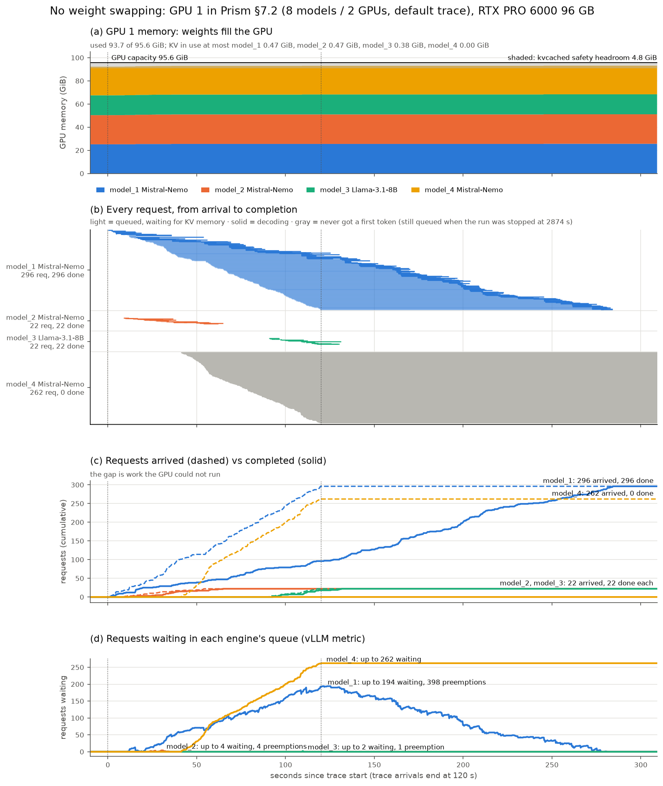
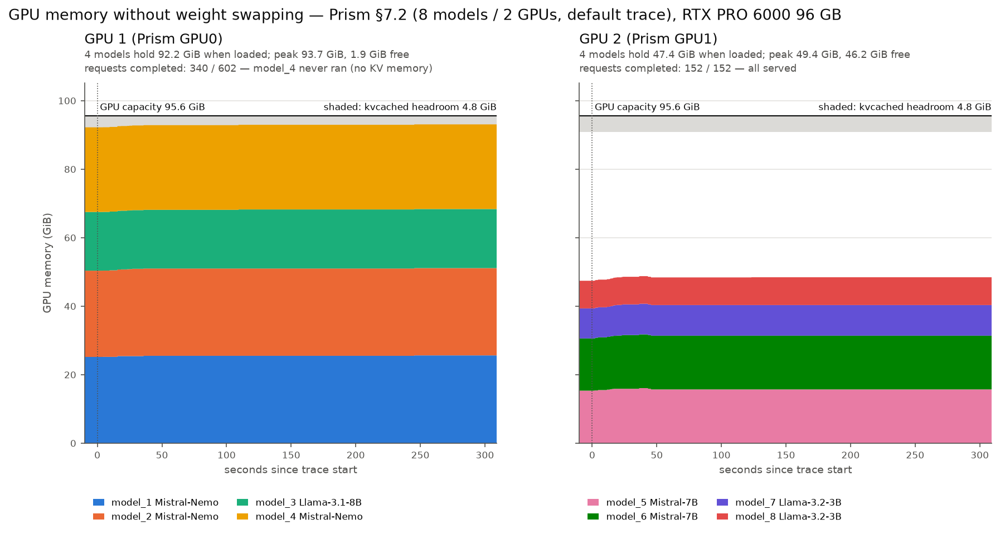
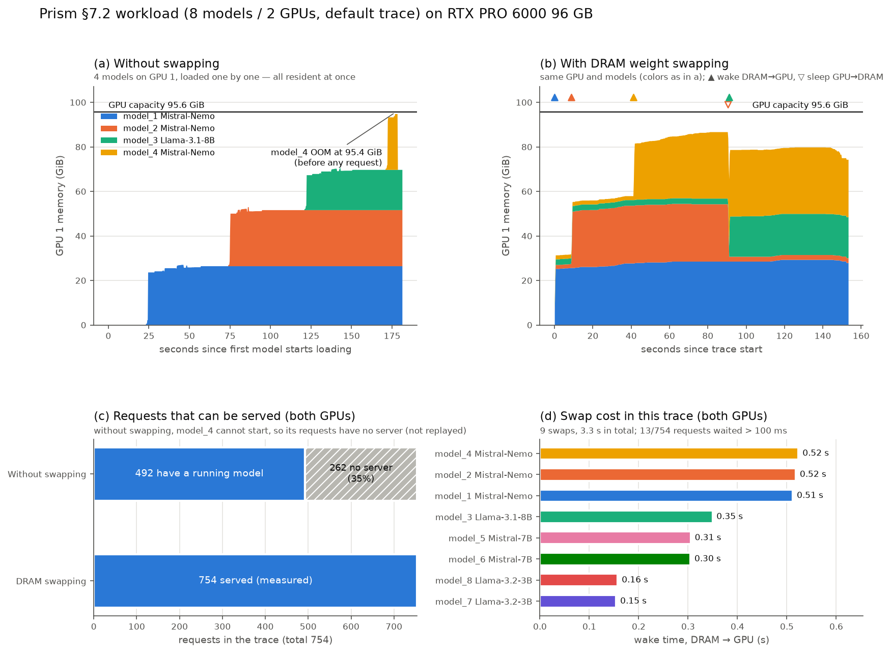

# kvcached-repro

在我們的機器（8× NVIDIA RTX PRO 6000 Blackwell，每張 96 GB）上重現 [kvcached](https://github.com/ovg-project/kvcached) 和 [Prism](https://arxiv.org/abs/2505.04021) 的 multi-LLM serving workload，量測 VRAM 壓力。目標是確認 multi-LLM serving 時 VRAM 會不會不夠，作為 weight swapping 和 KV offload 研究的 motivation。

## 主要結果：不做 weight swapping 時，GPU 1 的記憶體被塞滿，request 跑不動



圖是 GPU 1（Prism 的 GPU0：3× Mistral-Nemo-12B + Llama-3.1-8B），4 格共用同一條時間軸。

- **(a) 記憶體**：4 個模型的權重加上固定開銷用掉 93.7 / 95.6 GiB，只剩 kvcached 預設的 5% 安全保留空間（4.8 GiB，灰色）。能拿來放 KV 的空間：model_1 最多 0.47 GiB，**model_4 是 0**。
- **(b) 每個 request 的時間線**：一個 request 一條線，淺色是排隊、深色是生成、灰色是從來沒開始。
  - **model_4 的 262 個 request 沒有一個拿到第一個 token**。
  - model_1 的排隊時間愈拉愈長：trace 在 120 秒就停止送新 request，model_1 最後一個 request 卻到第 284 秒才完成，TTFT 中位數 94 秒。
- **(c) 累計到達 vs 完成**：model_4 到達 262 個、完成 0 個；model_1 的完成數一路落後到達數。
- **(d) 排隊數**（vLLM 回報）：model_4 升到 262 之後就一直維持；model_1 最多排到 194 個，並被搶佔 398 次。
- **原始證據**：`server_model_4.log` 裡 kvcached 連續幾千秒重複輸出 `Waiting for physical KV capacity ... reason=no_effective_capacity`。

圖由 `analysis/plot_noswap_timeline.py` 產生，資料在 `results/prism_8m2g_noswap_default/`。

### 兩張 GPU 的記憶體並排



- **左邊 GPU 1**（Prism 的 GPU0）：4 個模型載入後就佔掉 92.2 GiB，trace 期間最高 93.7 GiB，只剩 1.9 GiB，已經用到 kvcached 的安全保留區（灰色）。model_4 的 request 完全沒跑，GPU 1 只完成 340 / 602 個 request。
- **右邊 GPU 2**（Prism 的 GPU1）：4 個較小的模型共 49.4 GiB，還剩 46 GiB，152 / 152 個 request 全部完成。
- 兩格的 y 軸相同，可以直接比較。

圖由 `analysis/plot_noswap_memory.py` 產生。

## 實驗：Prism §7.2「8 個模型、2 張 GPU」，預設設定

| 項目 | 設定 |
|---|---|
| Workload | Prism repo 的 `real_trace.pkl`：Chatbot Arena 使用者對話紀錄的抽樣，只保留到達時間、目標模型、prompt 長度和輸出長度。trace 編號對應到 model_1–8，共 754 個 request，時間 ×0.2 後約 120 秒 |
| 模型與擺放 | Prism repo 的 `swap_8_2gpus.json`：GPU0 放 3× Mistral-Nemo-12B 和 Llama-3.1-8B；GPU1 放 2× Mistral-7B 和 2× Llama-3.2-3B |
| 對應到我們的 GPU | Prism 的 GPU0 對應我們的 GPU 1，GPU1 對應 GPU 2，容量都是 95.6 GiB |
| Engine | vLLM 0.30.0 + kvcached v0.1.6（`KVCACHED_GPU_UTILIZATION=0.95`，也就是保留 5% 安全空間） |

### Trace 的來源
- **論文 evaluation 用了兩份 trace**：Hyperbolic 和 Arena-Chat。
- **Hyperbolic** 是商業資料，沒有公開。
- **Arena-Chat**：論文 [arXiv v2](https://arxiv.org/abs/2505.04021v2)（2025 年 5 月）的 §7 寫的是「Arena-Chat [48]」，而 [48] 是 VTC 論文（Sheng et al., *Fairness in Serving Large Language Models*, OSDI'24）。Prism repo 的 `real_trace.pkl` 和 VTC artifact 公開的 `real_trace.pkl` 逐 byte 相同，repo 的實驗腳本也都使用它。所以這份 trace **很可能就是論文 evaluation 的 Arena-Chat**。
- **不能 100% 確定的地方**：論文和 repo 都沒有明寫檔名。另外論文描述的 Arena-Chat 有 84 個模型、11 天，這個檔案只有 27 個模型、壓縮成 600 秒，比較可能是從完整紀錄抽樣出來的版本。
- 論文 v3（2026 年 6 月）把這個引用改成 Chatbot Arena 平台本身。

### 結果（不做 swap）

| | GPU 1（3× Nemo-12B + Llama-8B） | GPU 2（2× Mistral-7B + 2× Llama-3B） |
|---|---|---|
| 權重 | 83.4 GiB | 39.0 GiB |
| trace 期間尖峰用量 | 93.7 / 95.6 GiB | 49.4 / 95.6 GiB |
| request | 340 / 602 完成：model_4 的 262 個全部卡在排隊 | 152 / 152 完成 |
| 最熱門模型 | model_1：TTFT 中位數 94 秒，被搶佔 398 次 | model_5：TTFT 中位數 0.04 秒，沒有被搶佔 |

- **GPU 2 是對照組**：同一次實驗、同一套程式。記憶體夠的那張卡一切正常，所以問題出在 GPU 1 的記憶體，不是設定或程式錯誤。
- **第一次跑同樣的實驗**（`results/prism_8m2g_kvcached_default/`）：GPU 1 的第 4 個模型在啟動的 profiling 階段就 OOM 了。兩次都是 GPU 1 裝不下 4 個模型的權重加上 KV，差別只是記憶體耗盡發生在啟動時還是服務時。
- **每個模型的固定開銷**：除了權重，還要 2.3–3.5 GiB，包括 CUDA context、activation 和 CUDA graph。
- **提早停止**：model_4 的 request 卡住後，重播在 trace 開始 2,874 秒後被手動停止。這 262 個 request 在 `requests.jsonl` 裡標記為 `added_after_stop: true`。

### 解讀時的限制

- **trace**：論文兩份 trace 中只有 Arena-Chat 有公開，而且很可能就是我們用的這份。Hyperbolic 沒有公開。
- **硬體**：論文用 H100 80 GB，我們是 96 GB，而且沒有 NVLink。
- **擺放**：VRAM 不夠主要是 repo 的初始擺放不平均造成的，GPU0 拿到 83 GiB 權重和 80% 的流量。如果把模型平均擺放，兩張 96 GB 都放得下。
- **安全保留空間**：model_4 配不到 KV，是因為剩下的空間低於 kvcached 預設的 5% 保留空間；實體記憶體其實還有約 2–3 GiB。就算把保留空間調低，model_4 能拿到的 KV 也很少，而且會有 OOM 風險。第一次實驗正是在啟動時 OOM 的。

## 附錄：DRAM weight swapping baseline

`scripts/swap_proxy.py` 是我們自己寫的策略（on-demand、LRU、drain），搬移權重則用 vLLM 的 sleep mode（level 1，權重在 GPU 和 host DRAM 之間搬移）。這屬於 time-sharing baseline，不是完整的 Prism。主要結論不依賴這部分，保留它是為了之後和 GDS/SSD 路徑比較。



| | 不做 swap | DRAM weight swapping |
|---|---|---|
| 結果資料夾 | `results/prism_8m2g_noswap_default/` | `results/prism_8m2g_swap_dram_default/` |
| request | 492 / 754 | 754 / 754 |
| model_1 TTFT 中位數 | 94 秒 | 0.17 秒 |
| swap | — | 9 次：8 次冷啟動喚醒、1 次換出。單次 0.15–0.52 秒，總共約 3.3 秒 |

- **單次 swap 的成本**：從 DRAM 喚醒一個模型需要 0.15–0.52 秒，大致和模型大小成正比。這是硬體加上 vLLM 機制的數字，和策略無關。
- **swap 次數少的原因**：這個 trace 雖然常常交錯，但 GPU 1 同時有 request 的模型最多 3 個，剛好放得下。所以 swap 不頻繁。
- **TPOT 變慢的原因**：DRAM swap 時 GPU 1 的 TPOT 中位數是 59–68 ms，約為單獨執行的 5–6 倍。原因是 3 個大模型同時 decode、互搶運算資源，不是 swap 造成的。

## 結果資料夾

| 資料夾 | 內容 |
|---|---|
| `results/comparison/` | 主圖 `prism_8m2g_noswap_timeline.png`、兩張 GPU 並排的記憶體圖 `prism_8m2g_noswap_memory.png`、附錄的對照圖 `prism_8m2g_comparison.png` |
| `results/memory_demand/` | 用 trace 算出的記憶體需求下界（時間 ×0.2）|
| `results/memory_demand_timescale1/` | 同上，時間不縮放 |
| `results/prism_8m2g_noswap_default/` | 實測，不做 swap（完整版：啟動失敗的模型會跳過，然後照樣重播 trace） |
| `results/prism_8m2g_kvcached_default/` | 實測，不做 swap（第一次：第 4 個模型啟動時 OOM，之後就停止了） |
| `results/prism_8m2g_swap_dram_default/` | 附錄：實測，DRAM weight swapping |
| `results/test_*`、`results/smoke_*` | **只是測試流程用，不能當結果引用**。`test_*` 用的是 Qwen3-8B 和人為設定；`smoke_*` 是最早的 kvcached 合成 workload，用的是 kvcached main，不是 v0.1.6 |

每次實測的資料夾裡有：

| 檔案 | 內容 |
|---|---|
| `summary.md`、`summary.json`、`report.png` | 總結表格和圖 |
| `config.txt` | 版本、設定和每個階段的時間戳 |
| `instances.tsv` | 每個模型的 GPU 和 port |
| `startup.tsv` | 每個模型啟動花的時間和記憶體 |
| `vram.csv` | 每 0.25 秒一筆：每張 GPU、每個模型的記憶體、KV 用量、排隊數、搶佔次數 |
| `requests.jsonl` | 每個 request 的 TTFT、TPOT、E2E |
| `swaps.jsonl`、`proxy_requests.jsonl` | 只有 swap 版本才有：每次 swap 的紀錄，以及每個 request 等 swap 的時間 |
| `server_*.log` | 每個 vLLM instance 的 log |

## 重跑

```bash
bash scripts/setup_env.sh                              # .venv：vLLM 0.30.0 + kvcached v0.1.6（CUDA 13.0 toolchain）
.venv/bin/python scripts/download_prism_models.py      # 下載 4 個模型的 HF safetensors

.venv/bin/python analysis/memory_demand.py && .venv/bin/python analysis/plot_memory_demand.py
CONTINUE_ON_FAIL=1 bash scripts/run_prism_trace.sh kvcached prism_8m2g_noswap_default   # 不做 swap
.venv/bin/python analysis/plot_noswap_timeline.py                                       # 主圖
.venv/bin/python analysis/plot_noswap_memory.py                                         # 兩張 GPU 的記憶體
SWAP=1 bash scripts/run_prism_trace.sh kvcached prism_8m2g_swap_dram_default           # 附錄：DRAM swap
.venv/bin/python analysis/plot_comparison.py                                            # 附錄：對照圖
```

GPU 預設用 1 和 2，可以用 `PRISM_GPUS="3 4"` 更改。GPU 0 通常被其他服務佔用。

## 目錄

| 路徑 | 內容 |
|---|---|
| `third_party/kvcached` | submodule，鎖在 v0.1.6 |
| `third_party/prism-research` | submodule，鎖在 `595ec1f` |
| `scripts/` | 啟動、監控、trace 重播、swap proxy |
| `analysis/` | 記憶體需求計算和報告產生 |
| `configs/experiment.env` | kvcached 三模型合成 workload 的設定 |
